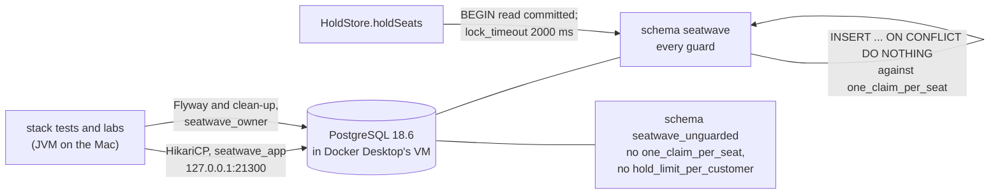

# Architecture

SeatWave's real PostgreSQL schema, the hold and booking transactions written against it, a broken twin of those transactions, and the tests that race both on PostgreSQL 18.6 to show which isolation level, lock and constraint stops which anomaly. This is the project of Module 13, "Tables and transactions", of the course System Design Fundamentals.

## Packages

All code is under `io.plainround.seatwave.transactions`.

| Package | What it holds | Needs PostgreSQL |
|---|---|---|
| `booking` | The domain values: `SeatLabel`, `HoldRequest` (with `seatsInLockOrder()`), `Hold`, `Booking`, and the sealed refusals `HoldRefusal` and `ConfirmRefusal` | no |
| `store` | `HoldStore` (the production hold, confirm and release), `Transactions` (one unit of work as one transaction at a named level, retrying only 40001 and 40P01), `RetryPolicy`, `SqlStates`, `IsolationLevel`, `Database` (pools, Flyway, the seed), and the broken twin `CheckThenWriteHolds` with its outcome `Attempt` | `HoldStore`, `CheckThenWriteHolds`, `Transactions`, `Database` |
| `race` | `Race` (a start barrier, one finish per racer) and `Gate` (a one-shot barrier that forces the worst interleaving) | no |
| `demo` | `InMemoryRaces` and `RaceDemoCli`: the same races on plain Java objects | no |
| `labs` | Lab 1's `ConditionalUpdateHold`, Lab 2's `SectionPrices` and `PriceRaceCli`, and `HoldTimingCli`, which times the hold transaction | yes |
| `config` | `SettingsReader` (from `seatwave-proxy` 1.0.1) and `StackSettings` | no |

## The dependency rule

`booking` depends on the JDK only. `store` depends on `booking`, `config`, `race` (the twin's gates) and the JDBC, HikariCP and Flyway libraries; it never prints. `labs` and `demo` depend on `store` and `race`. Only the three `*Cli` classes print or exit. The tests in `stack/` reach the database only through `store.Database` and the pools it opens.

## Data flow

## Walk-through: one hold

1. `HoldStore.holdSeats` asks `Transactions` for one transaction at read committed. `Transactions` borrows a connection, turns autocommit off, sets the level and `lock_timeout` (2,000 ms, for this transaction only).
2. For each seat in label order: an `UPDATE` marks a stale `ACTIVE` hold of that seat `EXPIRED` (lazy expiry), then `INSERT ... ON CONFLICT (event_id, seat_label) WHERE state IN ('ACTIVE', 'CONFIRMED') DO NOTHING` claims it.
3. Before the insert, the trigger `hold_limit_per_customer` locks the customer's row, counts the customer's active holds with a fresh snapshot, and refuses a fifth with a check violation named `hold_limit_per_customer`.
4. Zero rows inserted is `SeatTaken`; the trigger's refusal is `LimitReached`; a missing seat is `UnknownSeat`. A refusal is returned as a `Result` error and `Transactions` rolls the whole transaction back, so a group hold is all or nothing.
5. A success commits. A 40001 or 40P01 from any statement or the commit runs the whole unit again on a fresh connection, with full-jitter backoff, up to `retry.maxAttempts`.

## Walk-through: a race in a test

1. `StackDatabase.reset()` deletes holds, bookings and customers in both schemas as the owner (the application role has no `DELETE`).
2. `Race.run` creates one virtual thread per racer; all wait at one start line.
3. The broken twin reads, waits at a `Gate` until every racer has read, then writes. The production code has no gate: its correctness does not depend on the interleaving.
4. The test counts the outcome in the database, never only in what the code reported.

## Decisions and trade-offs

- **The rule lives in the database.** One claim per seat is a partial unique index; four holds per customer is a trigger that locks before it counts. Java checks can be skipped by a script or a later bug; these cannot.
- **Read committed for holds, chosen on purpose.** No decision in a hold rests on a value read earlier in the transaction. The trigger refuses repeatable read, where its count could be stale.
- **One lock order.** Seats are claimed sorted by label; a test proves the claim order, and the twin proves the other order deadlocks.
- **Retry only what the database aborted.** 40001 and 40P01 mean nothing was committed; a constraint refusal or a lock timeout is an answer and is never retried.
- **Two schemas from the same migrations.** The lab copy loses exactly two guards, so a difference between the two runs of the same broken code is caused by those two guards alone.
- **No embedded stand-in.** H2 implements none of PostgreSQL's snapshot, locking and constraint timing; the tests that need them are tagged `stack` and run against the real image, outside `./gradlew check`.
- **`max_connections=200`.** The tests open two application pools of 64 and two owner pools of 2; PostgreSQL's default of 100 could not hold them.

## Invariants and where they are enforced

| Invariant | Enforced by | Proven by |
|---|---|---|
| at most one live claim per seat | partial unique index `one_claim_per_seat` | `DoubleBookingStackTest` |
| at most one booking per seat | unique constraint `one_booking_per_seat` | `HoldStoreStackTest.refusesASecondBookingOfASoldSeatEvenWrittenByHand` |
| a booking matches its hold | composite foreign key `booking_matches_its_hold` and the confirm's one transaction | `HoldStoreStackTest` confirm tests |
| at most four active holds per customer | trigger `hold_limit_per_customer` (lock, then count; refuses repeatable read) | `DoubleBookingStackTest.theProductionHoldKeepsOneCustomerToFourActiveHolds`, `HoldStoreStackTest.makesAConcurrentFifthHoldWaitForTheFourthAndThenRefusesIt`, `HoldStoreStackTest.refusesAHoldWrittenAtRepeatableRead` |
| SeatWave cannot erase a record | `R__app_grants.sql`: no `DELETE`, no DDL for `seatwave_app` | `HoldStoreStackTest.neverLetsTheApplicationRoleDeleteABooking` |
| no deadlock between holds | `HoldRequest.seatsInLockOrder()` used by `HoldStore` | `HoldRequestTest`, `HoldStoreStackTest.claimsTheSeatsOfAGroupInLockOrder` |
| an invalid seat label or request cannot exist | compact constructors of `SeatLabel` and `HoldRequest` | `SeatLabelTest`, `HoldRequestTest` |
